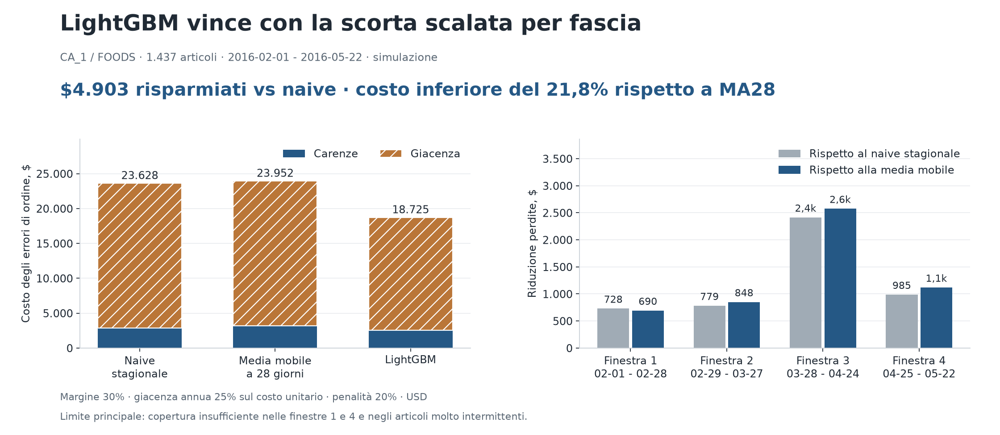
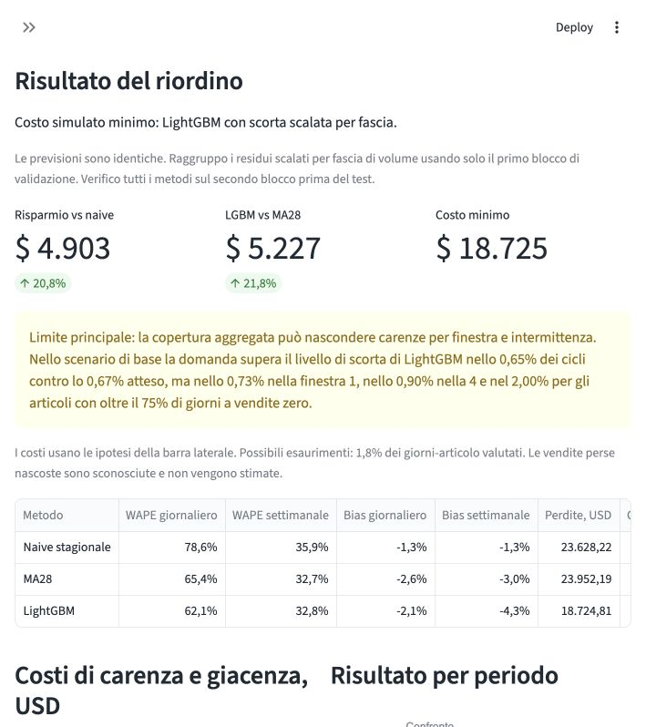
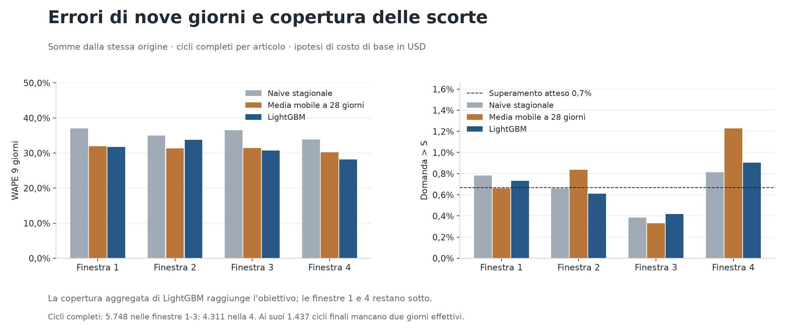
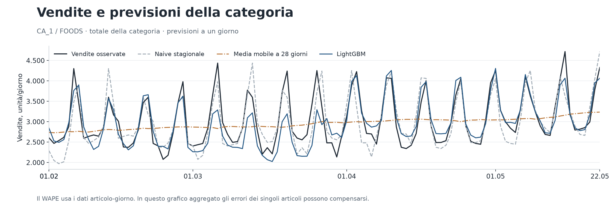
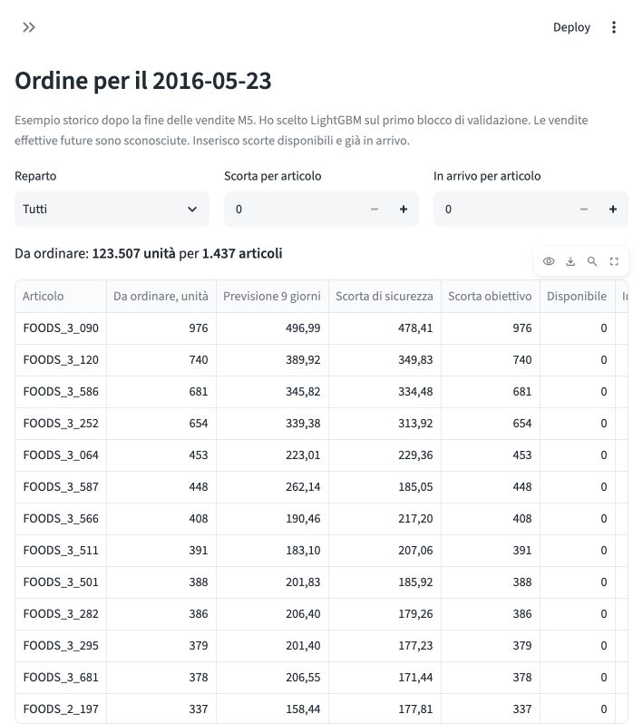
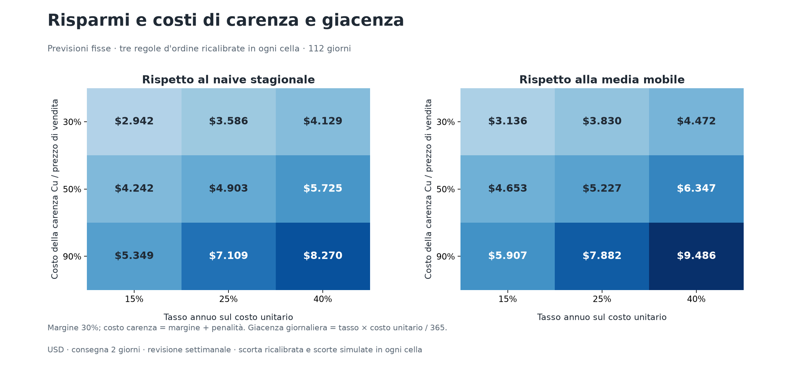
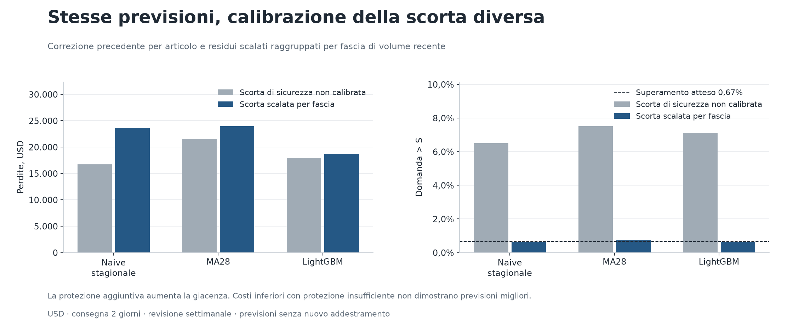
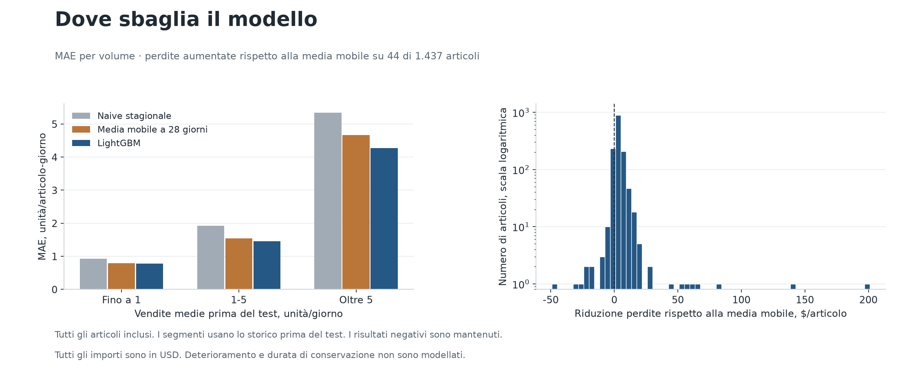

# Retail Demand Planner: previsioni e riordino settimanale

[English](README.md) | **Italiano**

Un negozio perde margine con scaffali vuoti e sostiene costi di giacenza con scorte eccessive. Valuto CA_1 / FOODS, 1.437 articoli, quattro finestre cronologiche e riordino settimanale con consegna in due giorni.

> **Risultato chiave:** con scorta scalata per fascia e stimata solo sulla validazione, **LightGBM ha il costo simulato più basso: $18.724,81**. Risparmia **$4.903,41 (20,75%) rispetto al naive stagionale** e **$5.227,38 (21,82%) rispetto a MA28**. Le previsioni sono identiche.
>
> **Limite principale:** la domanda supera il livello di scorta di LightGBM nello 0,65% dei cicli contro lo 0,67% atteso, ma non raggiungo il servizio nelle finestre 1 e 4 e negli articoli molto intermittenti (2,00% di superamenti). Nella seconda validazione il superamento era 0,72%. La copertura aggregata non garantisce il servizio.
>
> **La mia raccomandazione:** mantenere LightGBM con scorta scalata per fascia come candidato principale per ulteriori verifiche. Risolverei le carenze di copertura per gruppo e verificherei scorte e consegne effettive prima dell'uso operativo.

La metrica comprende **margine perso, penalità di carenza e costo di giacenza**, in **USD**, senza conversione. Sono perdite simulate con ipotesi esplicite, non utile contabile misurato. LightGBM costa meno in ogni finestra e in tutte le nove celle di costo.



## Avviare la demo

Previsioni e risultati sono inclusi. Per la demo non servono dati grezzi o nuovo addestramento.

```bash
git clone https://github.com/Gr1gorii/retail-demand-planner.git
cd retail-demand-planner
python3.11 -m venv .venv
source .venv/bin/activate
python -m pip install -r requirements-lock.txt
python -m streamlit run app.py --server.port 8509
```

Su Windows uso `.venv\Scripts\activate`. Su macOS LightGBM può richiedere `brew install libomp`.

Apro la [demo italiana](http://localhost:8509/?lang=it) o [inglese](http://localhost:8509/?lang=en). Il selettore cambia etichette, numeri e CSV degli ordini. I costi della barra laterale ristimano i quantili **solo sul primo blocco di validazione** e ripetono la stessa regola di scorta. Griglia e tabelle di validazione conservano i propri scenari dichiarati. Le cinque viste mostrano efficacia, ordini, sensibilità, errori e metodo.



## Problema della scorta precedente

La correzione precedente **non raggruppava articoli**: calcolava un quantile separato per metodo, finestra e articolo su 56 esiti sovrapposti di nove giorni. Al rapporto critico 99,33% stimava una coda estrema usando quasi il residuo massimo dell'articolo. Nel test i superamenti erano 6,50% per il naive, 7,12% per LightGBM e 7,51% per MA28, contro lo 0,67% atteso. La graduatoria dei costi confrontava protezioni insufficienti diverse e non dimostrava qualità delle previsioni.

Ora raggruppo **residui scalati tra articoli della stessa fascia di volume**, separatamente per metodo e finestra. Modifico soltanto la scorta di sicurezza. [forecast_sha256.json](results/forecast_sha256.json) verifica che modelli e previsioni siano identici.

## Ricalibrazione solo sulla validazione

A ogni origine calcolo livello recente e quota di zeri sui **28 giorni osservati fino al giorno precedente**. Il volume è basso a <= 1 unità/giorno, medio a > 1 fino a 5, alto a > 5. Il minimo di un'unità nella scala gestisce i livelli zero: è un'ipotesi fissa, non scelta sui risultati del test.

```text
scala_articolo = max(9 × MA28_recente, 1 unità)
residuo_scalato = (somma_effettiva_9giorni - previsione_9giorni) / scala_articolo
q = Cu / (Cu + Co)
quantile_fascia = quantile_q(residui_scalati del primo blocco)
scorta_sicurezza = quantile_fascia × scala_attuale_articolo
scorta_obiettivo = ceil(max(0, previsione_9giorni + scorta_sicurezza))
```

Fisso strategia, fasce e minimo prima del test. Divido le 56 origini esistenti in **28 nel primo blocco**, **otto di separazione** e **20 nel secondo blocco**. Tutti gli esiti di nove giorni del primo blocco terminano prima del secondo. Verifico il secondo in tre revisioni settimanali per finestra, **4.311 cicli per articolo**, prima di avviamento e test.

Nel primo blocco stimo i quantili su **14 origini**, lascio **otto origini** perché gli esiti siano completi e confronto i metodi sulle **sei origini finali** tramite perdita quantile media in unità. È un criterio di validazione, non il costo di scorta simulato. LightGBM vince in ogni finestra e nella validazione separata dell'esempio futuro. Stimo poi i quantili su tutte le 28 origini del primo blocco e **li fisso** prima della seconda verifica. Non ristimo sul secondo blocco e non modifico nulla dopo il test.

| Finestra | Naive | MA28 | LightGBM | Scelto |
| --- | --- | --- | --- | --- |
| 1 | 0,3890 | 0,4361 | 0,3303 | LightGBM |
| 2 | 0,4487 | 0,4877 | 0,4024 | LightGBM |
| 3 | 0,8211 | 0,8230 | 0,5820 | LightGBM |
| 4 | 0,3567 | 0,3873 | 0,3041 | LightGBM |

| Finestra | Primo blocco | Ultimo esito | Secondo blocco | Avviamento | Test |
| --- | --- | --- | --- | --- | --- |
| 1 | 2015-11-01 - 2015-11-28 | 2015-12-06 | 2015-12-07 - 2015-12-26 | 2016-01-04 - 2016-01-31 | 2016-02-01 - 2016-02-28 |
| 2 | 2015-11-29 - 2015-12-26 | 2016-01-03 | 2016-01-04 - 2016-01-23 | 2016-02-01 - 2016-02-28 | 2016-02-29 - 2016-03-27 |
| 3 | 2015-12-27 - 2016-01-23 | 2016-01-31 | 2016-02-01 - 2016-02-20 | 2016-02-29 - 2016-03-27 | 2016-03-28 - 2016-04-24 |
| 4 | 2016-01-24 - 2016-02-20 | 2016-02-28 | 2016-02-29 - 2016-03-19 | 2016-03-28 - 2016-04-24 | 2016-04-25 - 2016-05-22 |

Superamenti nella seconda validazione, con obiettivo comune 0,67%:

| Finestra | Metodo | Cicli | Superamento | Atteso |
| --- | --- | --- | --- | --- |
| Totale | Naive stagionale | 17.244 | 0,77% | 0,67% |
| Totale | MA28 | 17.244 | 0,83% | 0,67% |
| Totale | LightGBM | 17.244 | 0,72% | 0,67% |
| 1 | Naive stagionale | 4.311 | 0,93% | 0,67% |
| 1 | MA28 | 4.311 | 0,86% | 0,67% |
| 1 | LightGBM | 4.311 | 0,88% | 0,67% |
| 2 | Naive stagionale | 4.311 | 0,86% | 0,67% |
| 2 | MA28 | 4.311 | 1,21% | 0,67% |
| 2 | LightGBM | 4.311 | 0,72% | 0,67% |
| 3 | Naive stagionale | 4.311 | 0,42% | 0,67% |
| 3 | MA28 | 4.311 | 0,23% | 0,67% |
| 3 | LightGBM | 4.311 | 0,51% | 0,67% |
| 4 | Naive stagionale | 4.311 | 0,86% | 0,67% |
| 4 | MA28 | 4.311 | 1,02% | 0,67% |
| 4 | LightGBM | 4.311 | 0,77% | 0,67% |

La validazione mostra già copertura insufficiente in alcune finestre. Conservo la verifica fallita ed eseguo il test dichiarato una sola volta: **nove simulazioni, una per cella di costo**, ciascuna con tutti i metodi e tutte le finestre. Riutilizzo la cella di base per i risultati principali. [calibration_plan.json](results/calibration_plan.json), [validation_selection.csv](results/validation_selection.csv), [validation_check.csv](results/validation_check.csv), [validation_splits.csv](results/validation_splits.csv) e [calibration_quantiles.csv](results/calibration_quantiles.csv) conservano sequenza e valori stimati. In validation_selection.csv e validation_splits.csv, la finestra 0 indica l'esempio futuro separato; nelle tabelle di risultati e copertura indica il totale delle quattro finestre. Somme sovrapposte ed eventi comuni tra articoli sono dipendenti: il numero di residui non è un campione indipendente.

## Risultati: somme di nove giorni, copertura e costi

Valuto h = 1..9 emessi insieme durante ogni revisione, separatamente per articolo. WAPE e bias escludono la scorta di sicurezza. Il superamento è la quota dei cicli completi con `somma_osservata_9giorni > scorta_obiettivo`; l'uguaglianza conta come copertura. Il superamento atteso è **0,67%**, equivalente a servizio **99,33%**. Verifico la calibrazione dell'obiettivo, non la quota di unità servite o la probabilità di evitare un esaurimento fisico.

| Finestra | Metodo | WAPE 9 giorni | Bias 9 giorni | Domanda > S | Carenza, USD | Giacenza, USD | Totale, USD |
| --- | --- | --- | --- | --- | --- | --- | --- |
| Totale | Naive stagionale | 35,67% | -2,03% | 0,65% | $2.864,72 | $20.763,50 | $23.628,22 |
| Totale | MA28 | 31,27% | -0,99% | 0,73% | $3.153,83 | $20.798,36 | $23.952,19 |
| Totale | LightGBM | 31,23% | -3,95% | 0,65% | $2.547,90 | $16.176,91 | $18.724,81 |
| 1 | Naive stagionale | 37,06% | -1,34% | 0,78% | $501,66 | $3.583,21 | $4.084,87 |
| 1 | MA28 | 31,95% | -0,80% | 0,66% | $537,76 | $3.509,63 | $4.047,40 |
| 1 | LightGBM | 31,75% | 0,17% | 0,73% | $401,77 | $2.955,56 | $3.357,33 |
| 2 | Naive stagionale | 34,99% | -2,82% | 0,66% | $814,98 | $4.567,27 | $5.382,25 |
| 2 | MA28 | 31,36% | -0,67% | 0,84% | $871,77 | $4.579,55 | $5.451,32 |
| 2 | LightGBM | 33,73% | -16,20% | 0,61% | $725,74 | $3.877,46 | $4.603,20 |
| 3 | Naive stagionale | 36,54% | 0,10% | 0,38% | $324,71 | $8.002,47 | $8.327,18 |
| 3 | MA28 | 31,37% | 1,77% | 0,33% | $277,84 | $8.210,39 | $8.488,23 |
| 3 | LightGBM | 30,75% | 3,02% | 0,42% | $225,77 | $5.689,33 | $5.915,10 |
| 4 | Naive stagionale | 33,81% | -4,51% | 0,81% | $1.223,38 | $4.610,55 | $5.833,92 |
| 4 | MA28 | 30,23% | -4,99% | 1,23% | $1.466,46 | $4.498,79 | $5.965,25 |
| 4 | LightGBM | 28,20% | -2,55% | 0,90% | $1.194,62 | $3.654,55 | $4.849,18 |

Le finestre 1-3 hanno **5.748 cicli completi** ciascuna. Le somme finali includono due giorni osservati dopo la finestra valutata. La finestra 4 ha **4.311 cicli completi** ed esclude **1.437** della revisione del 16 maggio, perché mancano le vendite del 23-24 maggio. Tutti i metodi usano gli stessi **21.555 cicli completi**. I costi includono tutti i 28 giorni valutati, senza sommare costi sovrapposti. [protection_diagnostics.csv](results/protection_diagnostics.csv) e [review_cycles.parquet](results/review_cycles.parquet) conservano i dettagli e gli indicatori mancanti dei cicli incompleti.

**Perché cambia la graduatoria:** le previsioni puntuali restano identiche, incluso WAPE di nove giorni 35,67% per il naive e 31,23% per LightGBM. Con la correzione raggruppata LightGBM sostiene $2.547,90 di carenze e $16.176,91 di giacenza, meno dei $2.864,72 e $20.763,50 del naive, con vantaggio totale $4.903,41. Il superamento aggregato è 0,65% per entrambi, ma LightGBM non raggiunge l'obiettivo in due finestre e nella fascia più intermittente. Interpreto il risultato come confronto delle regole d'ordine con questa calibrazione e coperture ancora insufficienti, non come cambiamento della qualità delle previsioni.



## Superamenti per volume e intermittenza

Le quote prima/dopo usano gli stessi cicli completi, fasce MA28 recenti e quote di zeri dei 28 giorni precedenti. L'obiettivo è **0,67% in ogni riga**. `(75%, 100%]` esclude 75% e include 100%; la riga separata 0% non ha giorni recenti a zero.

| Fascia / quota zeri | Cicli | Naive: prima -> dopo | MA28: prima -> dopo | LGBM: prima -> dopo |
| --- | --- | --- | --- | --- |
| Basso | 10.502 | 8,35% -> 0,82% | 9,44% -> 0,86% | 7,92% -> 0,72% |
| Medio | 9.263 | 4,70% -> 0,50% | 5,61% -> 0,59% | 6,05% -> 0,53% |
| Alto | 1.790 | 4,92% -> 0,45% | 6,03% -> 0,73% | 7,99% -> 0,84% |
| 0% | 1.416 | 3,81% -> 0,28% | 4,59% -> 0,21% | 6,21% -> 0,42% |
| (0%, 25%] | 5.045 | 4,00% -> 0,10% | 4,72% -> 0,18% | 5,55% -> 0,24% |
| (25%, 50%] | 6.020 | 4,40% -> 0,40% | 4,62% -> 0,37% | 5,37% -> 0,48% |
| (50%, 75%] | 5.168 | 6,19% -> 0,29% | 7,41% -> 0,29% | 7,04% -> 0,29% |
| (75%, 100%] | 3.906 | 14,31% -> 2,36% | 16,77% -> 2,79% | 12,29% -> 2,00% |

La fascia bassa include vendite piccole ma regolari e articoli con periodi recenti a zero. Il raggruppamento può proteggere troppo alcuni articoli e mancare la coda di quelli intermittenti. La copertura aggregata 99,35% di LightGBM nasconde quindi **2,00% di superamenti** nella fascia con più zeri. [coverage_segments.csv](results/coverage_segments.csv) contiene tutti i metodi e le finestre; la [tabella precedente](results/uncalibrated/coverage_segments.csv) conserva la correzione originale.

## Accuratezza delle previsioni identica

Il WAPE giornaliero usa h = 1 per giorno-articolo. Il WAPE settimanale usa le somme h = 1..7 emesse insieme, senza aggiornamenti dopo aver visto vendite intermedie. Bias = `somma(previsione - osservato) / somma(osservato)`; WAPE = `somma(abs(previsione - osservato)) / somma(osservato)`. Gli errori possono compensarsi nel periodo dello stesso articolo, mai tra articoli.

| Finestra | Metodo | WAPE giorno | WAPE settimana | Bias giorno | Bias settimana |
| --- | --- | --- | --- | --- | --- |
| Totale | Naive stagionale | 78,59% | 35,87% | -1,33% | -1,33% |
| Totale | MA28 | 65,42% | 32,75% | -2,56% | -3,04% |
| Totale | LightGBM | 62,11% | 32,76% | -2,13% | -4,29% |
| 1 | Naive stagionale | 79,99% | 37,27% | -1,27% | -1,27% |
| 1 | MA28 | 65,89% | 33,71% | -2,59% | -3,32% |
| 1 | LightGBM | 62,72% | 33,43% | 0,25% | -0,57% |
| 2 | Naive stagionale | 77,48% | 35,16% | -2,83% | -2,83% |
| 2 | MA28 | 66,10% | 33,08% | -3,16% | -3,34% |
| 2 | LightGBM | 62,35% | 35,54% | -14,55% | -16,94% |
| 3 | Naive stagionale | 79,58% | 36,60% | 0,68% | 0,68% |
| 3 | MA28 | 65,75% | 32,19% | -0,10% | -0,26% |
| 3 | LightGBM | 63,18% | 31,98% | 5,79% | 2,14% |
| 4 | Naive stagionale | 77,44% | 34,60% | -1,87% | -1,87% |
| 4 | MA28 | 64,05% | 32,11% | -4,28% | -5,11% |
| 4 | LightGBM | 60,33% | 30,34% | -0,21% | -1,97% |



## Scorte e calcolo economico

Consegna **L = 2 giorni**, revisione **R = 7**, protezione **L + R = 9**. Rivedo prima della domanda di d, ricevo prima dell'apertura di d + 2 e prevedo d fino a d + 8. L'ordine è `max(0, obiettivo - disponibile - in_arrivo)`. Le scorte restano disponibili; la domanda osservata non servita è persa, senza arretrati, smaltimenti giornalieri o liquidazione finale. Ogni metodo parte da zero prima degli stessi **28 giorni di avviamento**; escludo i loro costi.

Le ipotesi di base sono margine lordo **30%**, tasso annuo **25% del costo unitario**, penalità aggiuntiva **20% del prezzo**. I prezzi M5 sono USD. Carenze e costo unitario usano lo stesso margine.

```text
costo_unitario = prezzo × (1 - margine)
giacenza_unità_giorno = tasso_annuo × costo_unitario / 365
Cu = prezzo × (margine + penalità)
Co = giacenza_unità_giorno × 7
q = Cu / (Cu + Co)
perdita_giornaliera = unità_mancanti × Cu + scorta_finale × giacenza_unità_giorno
```

Per un articolo da $10, costo unitario $7, giacenza $0,00479452 per unità-giorno, Cu $5, Co $0,03356164 e q 99,33%. Co è un'ipotesi marginale di sette giorni; la simulazione addebita la scorta finale effettiva ogni giorno. Uso il prezzo osservato o l'ultimo noto per i costi, ma soltanto prezzi già noti nelle variabili previsive.

```text
Perdita naive    = $2.864,720000 carenze + $20.763,498417 giacenza = $23.628,218417
Perdita MA28     = $3.153,830000 carenze + $20.798,361979 giacenza = $23.952,191979
Perdita LightGBM = $2.547,900000 carenze + $16.176,910855 giacenza = $18.724,810855
Risparmio vs naive = $23.628,218417 - $18.724,810855 = $4.903,407562
Risparmio vs MA28  = $23.952,191979 - $18.724,810855 = $5.227,381124
```

Sono differenze che escludono flussi di acquisto misurati, ammanchi, lavoro, capacità e utile contabile. L'[esempio di ordine](results/recommendations.csv) inizia il **2016-05-23**, dopo la fine delle vendite M5. Usa LightGBM scelto sul primo blocco della propria validazione, obiettivi calibrati e scorte inserite; l'esito futuro è sconosciuto.



## Stessa griglia 3×3 di costi

Il margine resta 30%. Penalità aggiuntiva 0% / 20% / 60%; tasso annuo **15% / 25% / 40% del costo unitario**. Ogni cella stima il proprio quantile sullo stesso primo blocco, verifica il secondo e ripete la regola di scorta una sola volta. N / M / L indicano naive / MA28 / LightGBM. L'obiettivo varia con il rapporto dei costi.

| Cu / prezzo | Tasso annuo | Naive, USD | MA28, USD | LGBM, USD | Risparmio vs naive | Risparmio vs MA28 | Superamento N / M / L | Atteso |
| --- | --- | --- | --- | --- | --- | --- | --- | --- |
| 30,00% | 15,00% | $14.176,93 | $14.371,32 | $11.234,89 | $2.942,04 | $3.136,43 | 0,65% / 0,73% / 0,65% | 0,67% |
| 30,00% | 25,00% | $17.495,65 | $17.739,59 | $13.909,22 | $3.586,43 | $3.830,36 | 1,12% / 1,10% / 1,03% | 1,11% |
| 30,00% | 40,00% | $21.635,11 | $21.978,33 | $17.506,33 | $4.128,78 | $4.472,00 | 1,64% / 1,76% / 1,54% | 1,76% |
| 50,00% | 15,00% | $19.397,80 | $19.808,23 | $15.155,60 | $4.242,20 | $4.652,63 | 0,44% / 0,44% / 0,42% | 0,40% |
| 50,00% | 25,00% | $23.628,22 | $23.952,19 | $18.724,81 | $4.903,41 | $5.227,38 | 0,65% / 0,73% / 0,65% | 0,67% |
| 50,00% | 40,00% | $28.611,57 | $29.233,87 | $22.886,76 | $5.724,81 | $6.347,11 | 1,08% / 1,08% / 1,00% | 1,06% |
| 90,00% | 15,00% | $26.262,01 | $26.819,73 | $20.913,01 | $5.349,01 | $5.906,73 | 0,28% / 0,30% / 0,26% | 0,22% |
| 90,00% | 25,00% | $33.725,74 | $34.499,06 | $26.617,22 | $7.108,52 | $7.881,83 | 0,38% / 0,42% / 0,38% | 0,37% |
| 90,00% | 40,00% | $40.177,49 | $41.393,38 | $31.907,67 | $8.269,82 | $9.485,71 | 0,60% / 0,61% / 0,56% | 0,59% |

[sensitivity_windows.csv](results/sensitivity_windows.csv) contiene tutte le **135 righe metodo-finestra-scenario**, con accuratezza di nove giorni, superamenti contro l'obiettivo, carenze, giacenza e totale. È analisi di scenario, non intervallo di confidenza. LightGBM costa meno in tutte le celle; i limiti di copertura restano visibili.



## Sensibilità: scorta di sicurezza non calibrata

Conservo sotto questa etichetta la correzione precedente, separata per articolo, su tutte le 56 origini sovrapposte, senza scala e senza raggruppamento. Previsioni, costi, consegne e finestre sono identici. Costi inferiori con protezione insufficiente non indicano previsioni migliori o servizio equivalente.

| Finestra | Metodo | WAPE 9 giorni | Bias 9 giorni | Domanda > S | Carenza, USD | Giacenza, USD | Totale, USD |
| --- | --- | --- | --- | --- | --- | --- | --- |
| Totale | Naive stagionale | 35,67% | -2,03% | 6,50% | $11.119,69 | $5.592,90 | $16.712,59 |
| Totale | MA28 | 31,27% | -0,99% | 7,51% | $16.759,70 | $4.756,65 | $21.516,35 |
| Totale | LightGBM | 31,23% | -3,95% | 7,12% | $13.299,83 | $4.632,78 | $17.932,61 |

Il vecchio scenario di base vedeva primo il naive, $1.220,01 meno costoso di LightGBM; LightGBM superava MA28 del 16,66%. La ricalibrazione aumenta la perdita dello stesso LightGBM di **$792,20**, principalmente per la giacenza della protezione aggiuntiva; cambia il confronto tra metodi. Conservo obiettivi, scorte, griglia e riepilogo originali in [results/uncalibrated](results/uncalibrated/summary.json).



## Sensibilità: scenario originale a un giorno

Il riferimento h = 1 usa consegna immediata, revisione giornaliera, recupero finale, acquisto 60%, recupero 20% e penalità 20%. Resta identico in USD. È uno scenario economico e di scorte diverso, che non isola la consegna.

| Metodo | WAPE h=1 | Bias h=1 | Perdite, USD |
| --- | --- | --- | --- |
| Naive stagionale | 78,59% | -1,33% | $379.515,49 |
| MA28 | 65,42% | -2,56% | $316.260,34 |
| LightGBM | 61,77% | -0,36% | $292.747,45 |

[daily_sensitivity.csv](results/daily_sensitivity.csv) contiene ogni finestra. In questo scenario LightGBM risparmia $23.512,88 rispetto a MA28 e $86.768,03 rispetto al naive.

## Dati, previsioni e controlli temporali

Uso vendite effettive [Kaggle M5](https://www.kaggle.com/competitions/m5-forecasting-accuracy/data), [scaricate da Zenodo](https://zenodo.org/records/10203108), con hash in [summary.json](results/summary.json). CA_1 / FOODS ha 1.941 giorni osservati per articolo. Valuto **2016-02-01 - 2016-05-22**, 160.944 giorni-articolo e 339.403 unità. I CSV grezzi sono esclusi; l'uso resta soggetto ai termini Kaggle.

Conservo nove modelli diretti LightGBM per finestra, uno per h = 1..9. Ogni osservazione termina nel giorno previsto t - h = origine d - 1. I nomi conservano lo schema h = 1; sotto riporto i ritardi effettivi rispetto al giorno previsto.

| h | lag_1 | lag_7 | lag_14 | lag_28 | mean_7 | mean_28 / std_28 / zero_share_28 / MA28 | price_known / price_change | Naive |
| --- | --- | --- | --- | --- | --- | --- | --- | --- |
| 1 | 1 | 7 | 14 | 28 | 1..7 | 1..28 | >= 1 | 7 |
| 2 | 2 | 8 | 15 | 29 | 2..8 | 2..29 | >= 2 | 7 |
| 3 | 3 | 9 | 16 | 30 | 3..9 | 3..30 | >= 3 | 7 |
| 4 | 4 | 10 | 17 | 31 | 4..10 | 4..31 | >= 4 | 7 |
| 5 | 5 | 11 | 18 | 32 | 5..11 | 5..32 | >= 5 | 7 |
| 6 | 6 | 12 | 19 | 33 | 6..12 | 6..33 | >= 6 | 7 |
| 7 | 7 | 13 | 20 | 34 | 7..13 | 7..34 | >= 7 | 7 |
| 8 | 8 | 14 | 21 | 35 | 8..14 | 8..35 | >= 8 | 14 |
| 9 | 9 | 15 | 22 | 36 | 9..15 | 9..36 | >= 9 | 14 |

`price_change` confronta prezzi noti ai ritardi h e h + 7, eventualmente più vecchi dopo il riempimento dal passato. Assumo noti identificatori statici, eventi e SNAP. Il naive usa ritardo 7 per h <= 7 e 14 per h = 8, 9. MA28 usa i 28 giorni prima dell'emissione. Non riempio prezzi dal futuro e non ordino prima che un prezzo sia noto. Dodici righe valutate non hanno prezzo, prima del primo prezzo registrato.

I modelli restano Poisson, 250 alberi, apprendimento 0,05, 31 foglie e seme 42. Ogni modello usa 730 valori prima della validazione. Non riaddestro nessuno dei 49 modelli salvati e non modifico previsioni. [feature_audit.csv](results/feature_audit.csv) elenca ogni ritardo e statistica mobile. Controlli e test rifiutano orizzonti mancanti, date errate ed esiti di validazione che raggiungono l'origine di un ordine.

## Errori e domanda censurata

Le perdite aumentano su **44 articoli rispetto a MA28**; conservo effetti negativi. I segmenti generali di errore usano 90 giorni prima dell'avviamento. Le fasce di calibrazione e copertura sopra usano invece MA28 e quota di zeri precedenti a ogni origine.



M5 registra vendite osservate, non domanda senza vincoli. Segnalo almeno sette giorni a zero dopo 90 giorni con media >= 1 e vendite positive in >= 80% dei giorni, con un prezzo già noto. Le segnalazioni retrospettive non entrano in previsioni, calibrazione o ordini. Comprendono **2.915 dei 160.944 giorni-articolo (1,81%)**, 78 articoli. Le vendite perse nascoste sono sconosciute e non imputate; simulo carenze rispetto alle sole vendite osservate. I giorni a zero restano nei totali e possono generare giacenza. Dati in [censoring_summary.json](results/censoring_summary.json).

## Riproduzione e test

Per un'esecuzione completa nuova:

```bash
python scripts/download_data.py --output data/raw
python -m src.pipeline --raw-dir data/raw --output results-new
python scripts/make_charts.py
python -m pytest -q
```

Il flusso addestra le previsioni originali, conserva la regola per articolo e poi calibra la scorta. Le figure usano la cartella consegnata `results`. Per risultati esistenti senza indicatore di calibrazione uso `python scripts/recalibrate_safety_stock.py --results results-old --raw-dir data/raw`, senza nuovo addestramento. Lo script rifiuta una seconda calibrazione su risultati già valutati; per un nuovo esperimento uso un output nuovo. `python scripts/make_diagnostics.py` rigenera le metriche dagli obiettivi salvati senza modificare regole.

Tutti i 51 test passano. Verificano ritardi, livelli precedenti all'origine, isolamento tra articoli, minimo della scala, raggruppamento, blocchi cronologici, selezione solo sul primo, conversione dei quantili in unità, limiti temporali, scorte, costi USD, hash delle previsioni e controlli bilingui. Ricalcolo indipendentemente livelli e quantili dai dati grezzi e ripeto tutti i metodi, le finestre e le nove celle senza usare le funzioni di calibrazione o simulazione; i costi coincidono entro $0,0000001. Calibrazione e nove test hanno richiesto 6,1 secondi su questa macchina con le previsioni salvate.

Il codice usa funzioni Python ordinarie: `src/calibration.py` stima la correzione, `src/recalibrate.py` salva verifiche e risultati, `src/inventory.py` conserva le scorte e `app.py` mostra la demo bilingue.

## Limiti e prossimi passi

- **La copertura fallisce ancora in alcune finestre, fasce e negli articoli molto intermittenti, pur raggiungendo l'obiettivo aggregato di LightGBM.** La seconda validazione manca leggermente anche l'obiettivo aggregato. Storie brevi e dipendenti non dimostrano un servizio di coda affidabile.
- Il quantile condiviso assume distribuzioni simili dei residui scalati. Cambi di fascia e minimo di un'unità possono produrre scorte grandi per livelli bassi. Non ottimizzo altre correzioni su questo test.
- **Deterioramento e durata di conservazione non sono modellati perché M5 non contiene dati di durata. È un limite importante per gli alimenti deperibili FOODS.** Il costo di giacenza permette disponibilità indefinita.
- Mancano scorte reali, consegne, costi unitari, confezioni e capacità. L'avviamento genera disponibilità simulate. Le vendite possono nascondere domanda persa e non ricreano sostituzioni dopo esaurimenti simulati.
- I costi sono ipotesi e quattro finestre primaverili di un negozio non dimostrano efficacia annuale.

Prossimi passi, elencati e non implementati:

- Addestrare direttamente sulla **somma di domanda di nove giorni**, con **perdita quantile al rapporto critico**, verificando copertura condizionata in periodi cronologici nuovi.
- Ottenere **scorte e consegne reali**, disponibilità, arrivi, durata e costi unitari concordati.
