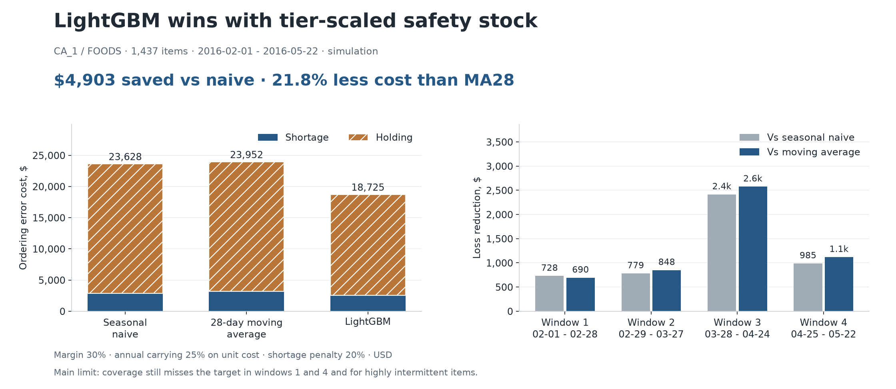
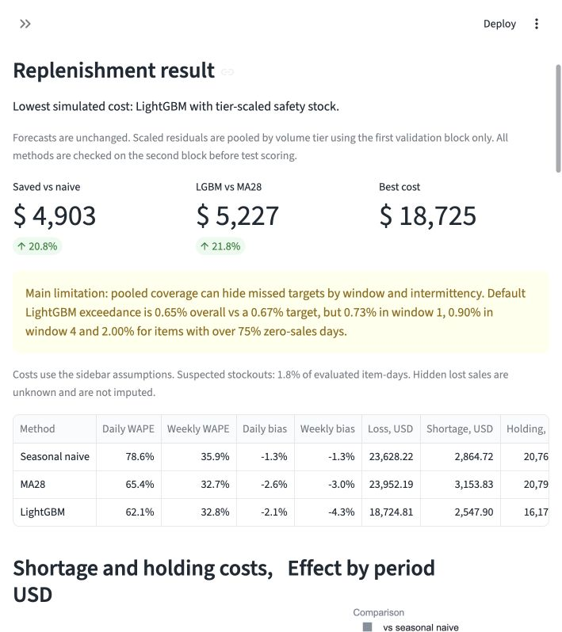
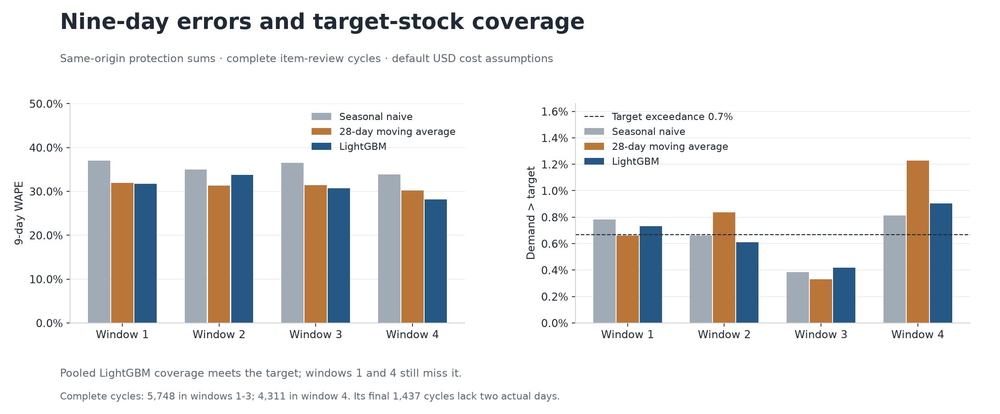
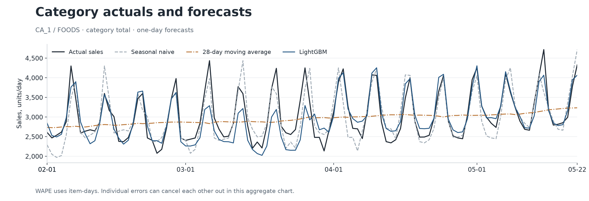
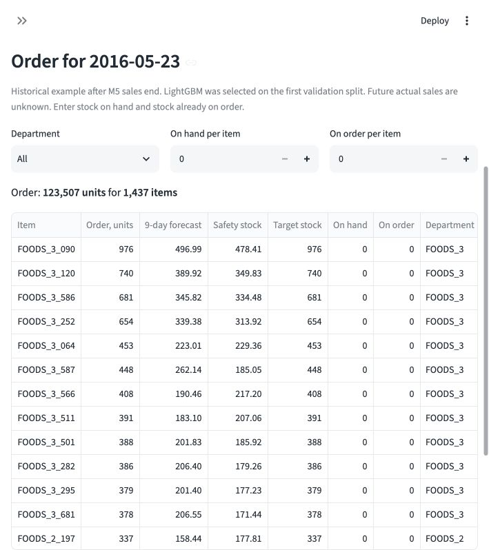
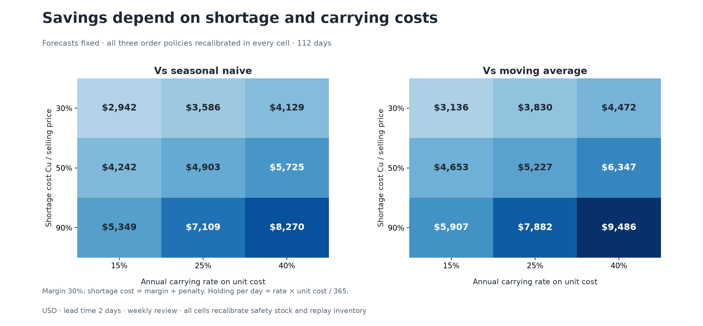
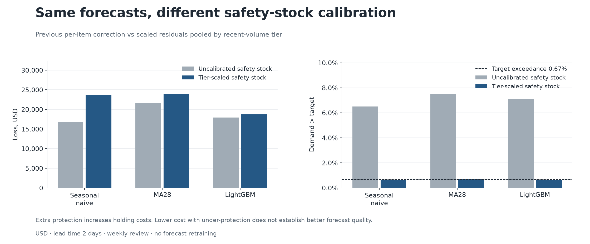
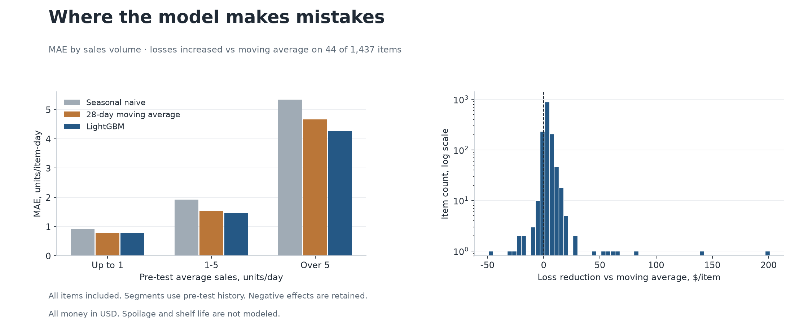

# Retail Demand Planner: forecasts and weekly replenishment

**English** | [Italiano](README.it.md)

A store loses margin on empty shelves and pays to carry excess stock. I test CA_1 / FOODS, 1,437 items, four chronological windows and a weekly order policy with a two-day lead time.

> **Key result:** with validation-only, tier-scaled safety stock, **LightGBM has the lowest simulated cost: $18,724.81**. It saves **$4,903.41 (20.75%) vs seasonal naive** and **$5,227.38 (21.82%) vs MA28**. Forecasts are unchanged.
>
> **Main limitation:** pooled LightGBM exceedance is 0.65% against a 0.67% target, but it still misses the target in windows 1 and 4 and among highly intermittent items (2.00% exceedance). Its second-validation exceedance was 0.72%. I do not treat pooled coverage as a service guarantee.
>
> **My recommendation:** keep LightGBM with tier-scaled safety stock as the leading candidate for further validation. I would resolve the subgroup coverage gaps and verify real stock and deliveries before deployment.

The metric is **missed margin plus shortage penalty plus carrying cost**, in **USD**, with no conversion. These are simulated losses under explicit assumptions, not measured accounting profit. LightGBM is cheapest in all four windows and all nine listed cost scenarios.



## Run the demo

Saved forecasts and results are included. The demo requires no raw data or retraining.

```bash
git clone https://github.com/Gr1gorii/retail-demand-planner.git
cd retail-demand-planner
python3.11 -m venv .venv
source .venv/bin/activate
python -m pip install -r requirements-lock.txt
python -m streamlit run app.py --server.port 8509
```

On Windows use `.venv\Scripts\activate`. On macOS LightGBM may require `brew install libomp`.

Open the [English demo](http://localhost:8509/?lang=en) or [Italian demo](http://localhost:8509/?lang=it). The selector changes labels, number formats and order CSV headers. Sidebar costs refit quantiles **only on the first validation block** and replay the same inventory policy. The saved cost grid and validation tables retain their listed default scenarios. The five views show results, orders, sensitivity, errors and methodology.



## What was wrong with the previous safety stock

The previous correction was **not pooled across items**: it took a separate residual quantile for each method, window and item from 56 overlapping nine-day outcomes. At a 99.33% critical ratio this estimates an extreme tail from roughly the largest item-specific residual. Test exceedance was 6.50% for naive, 7.12% for LightGBM and 7.51% for MA28, far above the 0.67% target. Its cost ranking compared policies with materially different under-protection and did not establish forecast quality.

I now pool **scaled residuals across items within each volume tier**, separately for each method and window. This change affects safety stock only. [forecast_sha256.json](results/forecast_sha256.json) verifies unchanged model files and forecast outputs.

## Validation-only recalibration

For every origin, I compute the recent level and zero-sales share from the **28 observed days ending the day before issue**. Volume is low at <= 1 unit/day, medium at > 1 to 5 and high at > 5. The one-unit scale floor handles zero recent levels explicitly; it is a fixed assumption, not a parameter chosen on test outcomes.

```text
scale_item = max(9 × recent_MA28, 1 unit)
scaled_residual = (actual_9day_sum - forecast_9day_sum) / scale_item
q = Cu / (Cu + Co)
tier_quantile = quantile_q(scaled_residuals in the first validation block)
safety_stock_item = tier_quantile × current_scale_item
target_stock = ceil(max(0, forecast_9day_sum + safety_stock_item))
```

The strategy, tier boundaries and floor are fixed before test scoring. I split the existing 56 validation origins into **28 first-block origins**, an **eight-origin gap**, and **20 second-block origins**. The gap ensures that every first-block nine-day outcome ends before the second block starts. The second block is checked at three weekly reviews per window, **4,311 item-review cycles**, before warm-up and test.

Inside the first block, I fit the tier quantiles on its first **14 origins**, leave **eight origins** for their complete outcomes, and compare all methods on the final **six origins** using mean quantile pinball loss in units. The selection loss is a validation criterion, not the simulated inventory cost. LightGBM wins this selection in each window and in the separate future-example validation. I then fit quantiles on all 28 first-block origins and **freeze them** before checking the second block. I do not refit on the second block or change anything after seeing test results.

| Window | Naive | MA28 | LightGBM | Selected |
| --- | --- | --- | --- | --- |
| 1 | 0.3890 | 0.4361 | 0.3303 | LightGBM |
| 2 | 0.4487 | 0.4877 | 0.4024 | LightGBM |
| 3 | 0.8211 | 0.8230 | 0.5820 | LightGBM |
| 4 | 0.3567 | 0.3873 | 0.3041 | LightGBM |

| Window | First block | Last first outcome | Second block | Warm-up | Test |
| --- | --- | --- | --- | --- | --- |
| 1 | 2015-11-01 - 2015-11-28 | 2015-12-06 | 2015-12-07 - 2015-12-26 | 2016-01-04 - 2016-01-31 | 2016-02-01 - 2016-02-28 |
| 2 | 2015-11-29 - 2015-12-26 | 2016-01-03 | 2016-01-04 - 2016-01-23 | 2016-02-01 - 2016-02-28 | 2016-02-29 - 2016-03-27 |
| 3 | 2015-12-27 - 2016-01-23 | 2016-01-31 | 2016-02-01 - 2016-02-20 | 2016-02-29 - 2016-03-27 | 2016-03-28 - 2016-04-24 |
| 4 | 2016-01-24 - 2016-02-20 | 2016-02-28 | 2016-02-29 - 2016-03-19 | 2016-03-28 - 2016-04-24 | 2016-04-25 - 2016-05-22 |

Second-validation exceedance, with the same 0.67% target:

| Window | Method | Cycles | Exceedance | Target |
| --- | --- | --- | --- | --- |
| Pooled | Seasonal naive | 17,244 | 0.77% | 0.67% |
| Pooled | MA28 | 17,244 | 0.83% | 0.67% |
| Pooled | LightGBM | 17,244 | 0.72% | 0.67% |
| 1 | Seasonal naive | 4,311 | 0.93% | 0.67% |
| 1 | MA28 | 4,311 | 0.86% | 0.67% |
| 1 | LightGBM | 4,311 | 0.88% | 0.67% |
| 2 | Seasonal naive | 4,311 | 0.86% | 0.67% |
| 2 | MA28 | 4,311 | 1.21% | 0.67% |
| 2 | LightGBM | 4,311 | 0.72% | 0.67% |
| 3 | Seasonal naive | 4,311 | 0.42% | 0.67% |
| 3 | MA28 | 4,311 | 0.23% | 0.67% |
| 3 | LightGBM | 4,311 | 0.51% | 0.67% |
| 4 | Seasonal naive | 4,311 | 0.86% | 0.67% |
| 4 | MA28 | 4,311 | 1.02% | 0.67% |
| 4 | LightGBM | 4,311 | 0.77% | 0.67% |

Validation already shows remaining undercoverage in some windows. I retain that failed check as evidence and run the predeclared test experiment once: **nine inventory replays, one for each cost cell**, each covering all three methods and all four windows. The default cell is reused for the main outputs. [calibration_plan.json](results/calibration_plan.json), [validation_selection.csv](results/validation_selection.csv), [validation_check.csv](results/validation_check.csv), [validation_splits.csv](results/validation_splits.csv) and [calibration_quantiles.csv](results/calibration_quantiles.csv) preserve this sequence and the fitted values. In validation_selection.csv and validation_splits.csv, fold 0 is the separate future example; in result and coverage tables, fold 0 is pooled across the four test folds. The overlapping sums and shared shocks across items are dependent; pooled sample counts are not independent sample sizes.

## Results: nine-day sums, coverage and costs

I score h = 1..9 forecasts issued together at each weekly review, separately for each item. Forecast WAPE and bias exclude safety stock. Exceedance is the share of complete item-review cycles with `observed_9day_sum > target_stock`; equality counts as covered. Target exceedance is **0.67%**, equivalent to target coverage **99.33%**. This checks target calibration, not unit fill rate or the probability of avoiding a physical stockout.

| Window | Method | 9-day WAPE | 9-day bias | Demand > target | Shortage, USD | Holding, USD | Total, USD |
| --- | --- | --- | --- | --- | --- | --- | --- |
| Pooled | Seasonal naive | 35.67% | -2.03% | 0.65% | $2,864.72 | $20,763.50 | $23,628.22 |
| Pooled | MA28 | 31.27% | -0.99% | 0.73% | $3,153.83 | $20,798.36 | $23,952.19 |
| Pooled | LightGBM | 31.23% | -3.95% | 0.65% | $2,547.90 | $16,176.91 | $18,724.81 |
| 1 | Seasonal naive | 37.06% | -1.34% | 0.78% | $501.66 | $3,583.21 | $4,084.87 |
| 1 | MA28 | 31.95% | -0.80% | 0.66% | $537.76 | $3,509.63 | $4,047.40 |
| 1 | LightGBM | 31.75% | 0.17% | 0.73% | $401.77 | $2,955.56 | $3,357.33 |
| 2 | Seasonal naive | 34.99% | -2.82% | 0.66% | $814.98 | $4,567.27 | $5,382.25 |
| 2 | MA28 | 31.36% | -0.67% | 0.84% | $871.77 | $4,579.55 | $5,451.32 |
| 2 | LightGBM | 33.73% | -16.20% | 0.61% | $725.74 | $3,877.46 | $4,603.20 |
| 3 | Seasonal naive | 36.54% | 0.10% | 0.38% | $324.71 | $8,002.47 | $8,327.18 |
| 3 | MA28 | 31.37% | 1.77% | 0.33% | $277.84 | $8,210.39 | $8,488.23 |
| 3 | LightGBM | 30.75% | 3.02% | 0.42% | $225.77 | $5,689.33 | $5,915.10 |
| 4 | Seasonal naive | 33.81% | -4.51% | 0.81% | $1,223.38 | $4,610.55 | $5,833.92 |
| 4 | MA28 | 30.23% | -4.99% | 1.23% | $1,466.46 | $4,498.79 | $5,965.25 |
| 4 | LightGBM | 28.20% | -2.55% | 0.90% | $1,194.62 | $3,654.55 | $4,849.18 |

Windows 1-3 have **5,748 complete cycles** each. Their final protection sums include two observed days after the scored window. Window 4 has **4,311 complete cycles** and excludes **1,437** from the May 16 review because May 23-24 sales are unavailable. All methods use the same **21,555 complete test cycles**. Cost totals retain all 28 scored days in each window, without summing overlapping cycle costs. [protection_diagnostics.csv](results/protection_diagnostics.csv) and [review_cycles.parquet](results/review_cycles.parquet) retain the detailed records, including nullable flags for incomplete cycles.

**Why the ranking changed:** all point forecasts remain identical, including nine-day WAPE 35.67% for naive and 31.23% for LightGBM. With the pooled correction, LightGBM incurs $2,547.90 shortage cost and $16,176.91 holding cost, both lower than naive's $2,864.72 and $20,763.50, giving $4,903.41 lower total cost. Pooled exceedance is 0.65% for both, but LightGBM still misses the target in two windows and the most intermittent band. I interpret this as a comparison of ordering outcomes under the specified calibration, with remaining coverage gaps, rather than a change in forecast quality.



## Exceedance by volume and intermittency

The following before/after shares use the same complete test cycles, recent MA28 tiers and past-28-day zero-sales bands. The target is **0.67% in every row**. A band such as `(75%, 100%]` excludes 75% and includes 100%; the separate 0% row contains no recent zero-sales days.

| Tier / zero-day share | Cycles | Naive: before -> after | MA28: before -> after | LGBM: before -> after |
| --- | --- | --- | --- | --- |
| Low | 10,502 | 8.35% -> 0.82% | 9.44% -> 0.86% | 7.92% -> 0.72% |
| Medium | 9,263 | 4.70% -> 0.50% | 5.61% -> 0.59% | 6.05% -> 0.53% |
| High | 1,790 | 4.92% -> 0.45% | 6.03% -> 0.73% | 7.99% -> 0.84% |
| 0% | 1,416 | 3.81% -> 0.28% | 4.59% -> 0.21% | 6.21% -> 0.42% |
| (0%, 25%] | 5,045 | 4.00% -> 0.10% | 4.72% -> 0.18% | 5.55% -> 0.24% |
| (25%, 50%] | 6,020 | 4.40% -> 0.40% | 4.62% -> 0.37% | 5.37% -> 0.48% |
| (50%, 75%] | 5,168 | 6.19% -> 0.29% | 7.41% -> 0.29% | 7.04% -> 0.29% |
| (75%, 100%] | 3,906 | 14.31% -> 2.36% | 16.77% -> 2.79% | 12.29% -> 2.00% |

The broad low-volume tier contains both steady low sellers and items with recent zero runs. Pooling can overprotect some items while still missing the tail for intermittent ones. LightGBM's aggregate 99.35% coverage therefore hides the **2.00% exceedance** in the highest-zero band. [coverage_segments.csv](results/coverage_segments.csv) reports all methods and windows; the [preserved segment table](results/uncalibrated/coverage_segments.csv) contains the previous correction.

## Forecast accuracy is unchanged

Daily WAPE uses item-days at h = 1. Weekly WAPE uses h = 1..7 sums issued together at a review, not seven daily forecasts updated after observing intervening sales. Bias is `sum(forecast - observed) / sum(observed)`; WAPE is `sum(abs(forecast - observed)) / sum(observed)`. Errors may cancel within an item-period, never across items.

| Window | Method | Daily WAPE | Weekly WAPE | Daily bias | Weekly bias |
| --- | --- | --- | --- | --- | --- |
| Pooled | Seasonal naive | 78.59% | 35.87% | -1.33% | -1.33% |
| Pooled | MA28 | 65.42% | 32.75% | -2.56% | -3.04% |
| Pooled | LightGBM | 62.11% | 32.76% | -2.13% | -4.29% |
| 1 | Seasonal naive | 79.99% | 37.27% | -1.27% | -1.27% |
| 1 | MA28 | 65.89% | 33.71% | -2.59% | -3.32% |
| 1 | LightGBM | 62.72% | 33.43% | 0.25% | -0.57% |
| 2 | Seasonal naive | 77.48% | 35.16% | -2.83% | -2.83% |
| 2 | MA28 | 66.10% | 33.08% | -3.16% | -3.34% |
| 2 | LightGBM | 62.35% | 35.54% | -14.55% | -16.94% |
| 3 | Seasonal naive | 79.58% | 36.60% | 0.68% | 0.68% |
| 3 | MA28 | 65.75% | 32.19% | -0.10% | -0.26% |
| 3 | LightGBM | 63.18% | 31.98% | 5.79% | 2.14% |
| 4 | Seasonal naive | 77.44% | 34.60% | -1.87% | -1.87% |
| 4 | MA28 | 64.05% | 32.11% | -4.28% | -5.11% |
| 4 | LightGBM | 60.33% | 30.34% | -0.21% | -1.97% |



## Inventory and money

Lead time **L = 2 days**, review **R = 7 days**, protection **L + R = 9 days**. I review before demand on d, receive before opening on d + 2 and forecast d through d + 8. Orders use `max(0, target - on_hand - on_order)`. Unsold stock carries forward, unmet observed sales are lost without backorders, and there is no daily disposal or terminal liquidation. Each method starts with zero stock before the same **28-day warm-up**; warm-up costs are excluded.

The base gross margin is **30%**, annual carrying rate **25% of unit cost**, extra shortage penalty **20% of selling price**. M5 prices are USD. Shortage and unit cost use the same margin.

```text
unit_cost = price × (1 - margin)
holding_per_unit_day = annual_rate × unit_cost / 365
Cu = price × (margin + shortage_penalty)
Co = holding_per_unit_day × 7
q = Cu / (Cu + Co)
daily_loss = shortage_units × Cu + closing_stock × holding_per_unit_day
```

For a $10 item, unit cost is $7, holding is $0.00479452 per unit-day, Cu is $5, Co is $0.03356164 and q is 99.33%. Co is a marginal seven-day calibration assumption; the simulation charges actual closing stock every day. Scoring uses the observed daily price or the last known fallback, while forecast features use only previously known prices.

```text
Naive loss    = $2,864.720000 shortage + $20,763.498417 holding = $23,628.218417
MA28 loss     = $3,153.830000 shortage + $20,798.361979 holding = $23,952.191979
LightGBM loss = $2,547.900000 shortage + $16,176.910855 holding = $18,724.810855
Saved vs naive = $23,628.218417 - $18,724.810855 = $4,903.407562
Saved vs MA28  = $23,952.191979 - $18,724.810855 = $5,227.381124
```

These differences exclude measured procurement cash flows, shrinkage, labor, capacity and accounting profit. The [order example](results/recommendations.csv) starts on **2016-05-23**, after observed M5 sales end. It uses LightGBM selected on its first validation block, the calibrated nine-day target and user-entered stock; its future outcome is unknown.



## Same 3×3 cost grid

Gross margin stays at 30%. Extra shortage penalty is 0% / 20% / 60%; annual carrying rate is **15% / 25% / 40% of unit cost**. Each cell fits its critical-ratio quantile on the same first validation block, checks the same second block, then replays the unchanged inventory policy once. N / M / L means naive / MA28 / LightGBM. The target changes with the cost ratio.

| Cu / price | Annual rate | Naive, USD | MA28, USD | LGBM, USD | Saved vs naive | Saved vs MA28 | Exceedance N / M / L | Target |
| --- | --- | --- | --- | --- | --- | --- | --- | --- |
| 30.00% | 15.00% | $14,176.93 | $14,371.32 | $11,234.89 | $2,942.04 | $3,136.43 | 0.65% / 0.73% / 0.65% | 0.67% |
| 30.00% | 25.00% | $17,495.65 | $17,739.59 | $13,909.22 | $3,586.43 | $3,830.36 | 1.12% / 1.10% / 1.03% | 1.11% |
| 30.00% | 40.00% | $21,635.11 | $21,978.33 | $17,506.33 | $4,128.78 | $4,472.00 | 1.64% / 1.76% / 1.54% | 1.76% |
| 50.00% | 15.00% | $19,397.80 | $19,808.23 | $15,155.60 | $4,242.20 | $4,652.63 | 0.44% / 0.44% / 0.42% | 0.40% |
| 50.00% | 25.00% | $23,628.22 | $23,952.19 | $18,724.81 | $4,903.41 | $5,227.38 | 0.65% / 0.73% / 0.65% | 0.67% |
| 50.00% | 40.00% | $28,611.57 | $29,233.87 | $22,886.76 | $5,724.81 | $6,347.11 | 1.08% / 1.08% / 1.00% | 1.06% |
| 90.00% | 15.00% | $26,262.01 | $26,819.73 | $20,913.01 | $5,349.01 | $5,906.73 | 0.28% / 0.30% / 0.26% | 0.22% |
| 90.00% | 25.00% | $33,725.74 | $34,499.06 | $26,617.22 | $7,108.52 | $7,881.83 | 0.38% / 0.42% / 0.38% | 0.37% |
| 90.00% | 40.00% | $40,177.49 | $41,393.38 | $31,907.67 | $8,269.82 | $9,485.71 | 0.60% / 0.61% / 0.56% | 0.59% |

[sensitivity_windows.csv](results/sensitivity_windows.csv) contains all **135 method-window-scenario rows**, including nine-day accuracy, exceedance versus target, shortage/holding splits and total cost. This is scenario analysis, not a confidence interval. LightGBM is cheapest in all nine cells; their coverage limitations remain visible.



## Sensitivity: uncalibrated safety stock

I preserve the previous per-item correction under this label, with all 56 overlapping residuals, no level scaling and no cross-item pooling. It uses exactly the same forecasts, costs, delivery rule and windows. Lower losses alongside severe under-protection are not evidence of a better forecast or equivalent service.

| Window | Method | 9-day WAPE | 9-day bias | Demand > target | Shortage, USD | Holding, USD | Total, USD |
| --- | --- | --- | --- | --- | --- | --- | --- |
| Pooled | Seasonal naive | 35.67% | -2.03% | 6.50% | $11,119.69 | $5,592.90 | $16,712.59 |
| Pooled | MA28 | 31.27% | -0.99% | 7.51% | $16,759.70 | $4,756.65 | $21,516.35 |
| Pooled | LightGBM | 31.23% | -3.95% | 7.12% | $13,299.83 | $4,632.78 | $17,932.61 |

The old default ranked seasonal naive first: it was $1,220.01 cheaper than LightGBM, while LightGBM beat MA28 by 16.66%. Recalibration raises LightGBM's own loss by **$792.20**, mainly by charging more carrying cost for extra protection; its comparison with the other methods is now different. I keep the original targets, stock paths, cost grid and summary in [results/uncalibrated](results/uncalibrated/summary.json).



## Sensitivity: original next-day setup

The original h = 1 reference uses immediate delivery, daily review, day-end salvage, purchase 60%, salvage 20% and shortage penalty 20%. It remains unchanged in USD and uses a different inventory/cost scenario, so it does not isolate lead time.

| Method | h=1 WAPE | h=1 bias | Loss, USD |
| --- | --- | --- | --- |
| Seasonal naive | 78.59% | -1.33% | $379,515.49 |
| MA28 | 65.42% | -2.56% | $316,260.34 |
| LightGBM | 61.77% | -0.36% | $292,747.45 |

[daily_sensitivity.csv](results/daily_sensitivity.csv) contains every window. LightGBM saves $23,512.88 vs MA28 and $86,768.03 vs naive in that scenario.

## Data, forecasts and leakage guards

I use actual [Kaggle M5](https://www.kaggle.com/competitions/m5-forecasting-accuracy/data) sales, [downloaded from Zenodo](https://zenodo.org/records/10203108), with source hashes in [summary.json](results/summary.json). CA_1 / FOODS has 1,941 observed days per item. I score **2016-02-01 - 2016-05-22**, 160,944 item-days and 339,403 observed units. Raw CSVs are excluded; data use remains subject to Kaggle terms.

I keep nine direct LightGBM models per window, one for each h = 1..9. All observation features end at target day t - h = origin d - 1. Lag names retain the h = 1 template; the following values are actual lags relative to each target.

| h | lag_1 | lag_7 | lag_14 | lag_28 | mean_7 | mean_28 / std_28 / zero_share_28 / MA28 | price_known / price_change | Naive |
| --- | --- | --- | --- | --- | --- | --- | --- | --- |
| 1 | 1 | 7 | 14 | 28 | 1..7 | 1..28 | >= 1 | 7 |
| 2 | 2 | 8 | 15 | 29 | 2..8 | 2..29 | >= 2 | 7 |
| 3 | 3 | 9 | 16 | 30 | 3..9 | 3..30 | >= 3 | 7 |
| 4 | 4 | 10 | 17 | 31 | 4..10 | 4..31 | >= 4 | 7 |
| 5 | 5 | 11 | 18 | 32 | 5..11 | 5..32 | >= 5 | 7 |
| 6 | 6 | 12 | 19 | 33 | 6..12 | 6..33 | >= 6 | 7 |
| 7 | 7 | 13 | 20 | 34 | 7..13 | 7..34 | >= 7 | 7 |
| 8 | 8 | 14 | 21 | 35 | 8..14 | 8..35 | >= 8 | 14 |
| 9 | 9 | 15 | 22 | 36 | 9..15 | 9..36 | >= 9 | 14 |

`price_change` compares prices known at lags h and h + 7, which may be older after forward filling. Static IDs and future calendar events/SNAP are assumed known. Seasonal naive uses target lag 7 for h <= 7 and 14 for h = 8, 9. MA28 averages the 28 days ending before the issue day. There is no backward price fill; no order is placed before a price is known. Twelve scored rows have no price, before an item's first recorded price.

Model settings remain Poisson, 250 trees, learning rate 0.05, 31 leaves and seed 42. Each model uses 730 training targets ending before validation. The recalibration does not retrain any of the 49 saved models or change any forecast. [feature_audit.csv](results/feature_audit.csv) lists every lag/rolling feature. Guards and tests reject missing horizons, wrong target dates and validation outcomes reaching an order origin.

## Errors and censored demand

Loss increases on **44 items vs MA28**; I retain negative contributions. Error-analysis volume/pattern segments use 90 days before warm-up. The calibration and coverage tiers above instead use the causal MA28 and zero share before each origin.



M5 records observed sales, not unconstrained demand. I flag zero runs of at least seven days after 90 days with mean sales >= 1 and positive sales on >= 80% of days, with a price already known. These retrospective flags never enter forecasts, calibration or orders. They cover **2,915 of 160,944 item-days (1.81%)**, 78 items. Hidden lost sales are unknown and not imputed; simulated shortages use observed sales only. Flagged zero days stay in totals and can incur holding costs. See [censoring_summary.json](results/censoring_summary.json).

## Reproduce and test

For a fresh full run:

```bash
python scripts/download_data.py --output data/raw
python -m src.pipeline --raw-dir data/raw --output results-new
python scripts/make_charts.py
python -m pytest -q
```

The pipeline trains the original forecasts, preserves the item-specific policy and then calibrates safety stock. Charts use the delivered `results` directory. For an existing output without the calibrated marker, `python scripts/recalibrate_safety_stock.py --results results-old --raw-dir data/raw` recalibrates without retraining. The script refuses a second calibration pass on an already-scored output; use a fresh output for another experiment. `python scripts/make_diagnostics.py` rebuilds diagnostic tables from saved targets without changing a policy.

All 51 tests pass. They cover horizon leakage, source-time levels, item isolation, zero-level floors, tier pooling, chronological splits, first-block-only selection, quantile conversion back to units, validation cutoffs, stock flows, raw USD costs, saved forecast hashes and bilingual controls. I independently recompute recent levels and tier quantiles from raw M5 sales and replay all three methods in all four windows and nine cost scenarios without calling the calibration or simulation helpers; costs reconcile within $0.0000001. Calibration and nine test replays took 6.1 seconds on this machine, using saved forecasts.

The main code is ordinary Python functions: `src/calibration.py` fits the correction, `src/recalibrate.py` saves its validation evidence and policy results, `src/inventory.py` carries stock, and `app.py` shows the bilingual demo.

## Limitations and next steps

- **Coverage still fails in specific windows, volume tiers and highly intermittent items, despite meeting the pooled LightGBM target.** The second validation check also misses the pooled target slightly. Short, dependent histories do not establish reliable tail service.
- A shared tier quantile assumes similarly scaled residual distributions. Tier changes and the one-unit floor can produce large buffers for low-level items. I do not tune another correction on these test outcomes.
- **Spoilage and shelf life are not modeled because M5 has no shelf-life data. This is a material limitation for perishable FOODS items.** Carrying cost permits stock to remain available indefinitely.
- Actual stock, deliveries, unit costs, pack sizes and shelf capacity are unavailable. Warm-up supplies simulated opening balances. Observed sales can hide lost demand and do not recreate substitutions after simulated stockouts.
- Costs are assumptions, and four spring windows from one store do not demonstrate year-round performance.

Next steps, listed and not implemented:

- Train directly on the **nine-day demand sum**, with **quantile loss at the critical ratio**, and check conditional coverage on new chronological periods.
- Obtain **real stock and delivery data**, including availability, arrivals, shelf life and agreed unit costs.
